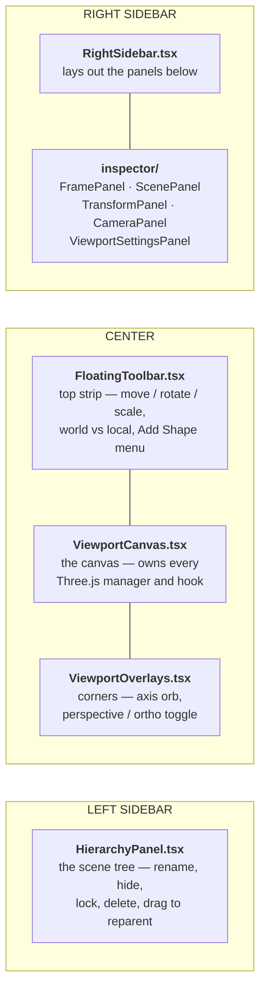
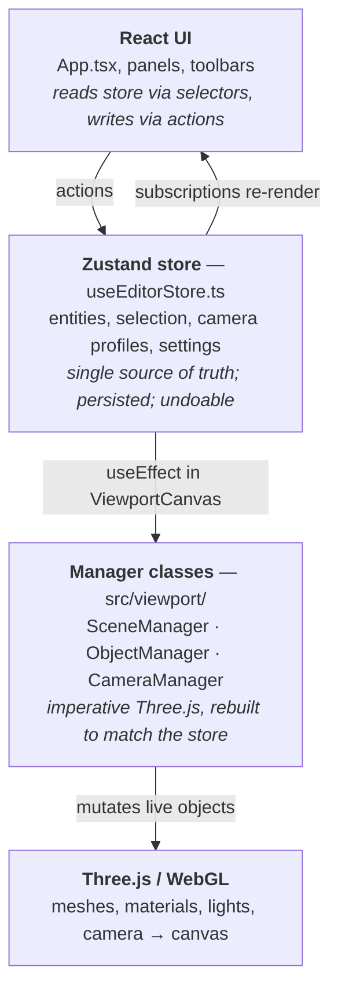
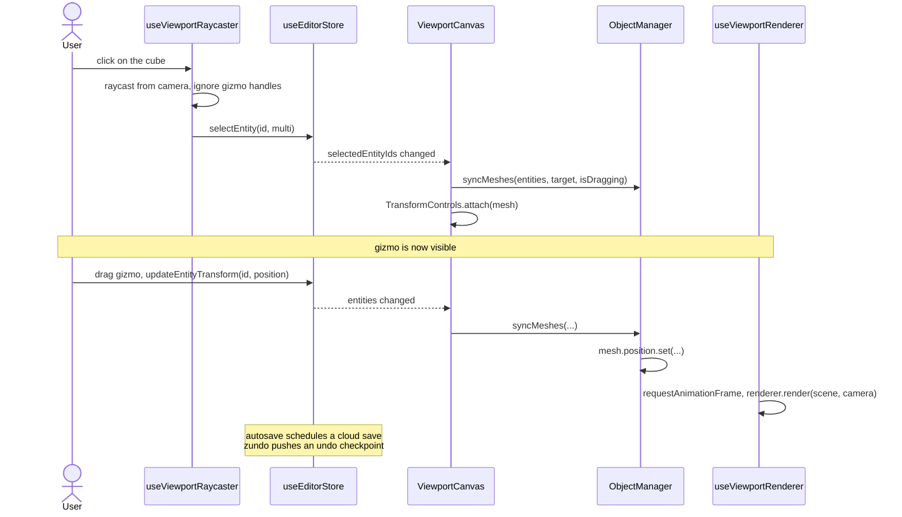

# Libre3D Architecture

Everything in Libre3D is one loop: **you do something → the store changes → the Three.js scene is rebuilt to match → the screen redraws.** If you understand that loop, you can find your way around any part of this codebase.

This document is the map. Read it once before your first change.

---

## 1. The editor, region by region

Every region of the UI is owned by one file. Run `pnpm dev`, put the editor on one half of your screen and this diagram on the other — when you want to change something you can see, this is where you look:



The editor is one page of several. `App.tsx` hand-routes between them (no router library; `navigate()` in `utils/navigation.ts` changes pages without a reload): `/` is the landing page, `/scenes` the gallery, `/edit/:sceneId` the editor above (`EditorApp.tsx`, lazy-loaded so the other pages never download Three.js), `/try` the same editor without an account (`GuestEditorApp.tsx`), and `/v/:sceneId` the read-only `PublicViewer` for published scenes. Every route also needs a rewrite in `vercel.json`.

Scenes live in the cloud, one per row of the signed-in user's gallery. Opening `/edit/:sceneId` loads that scene into the store (`useOpenScene` → `loadScene`, which also clears undo history), and from then on edits are autosaved (`useSceneAutosave`). A guest at `/try` instead gets one scene kept in this browser (`utils/guestScene.ts`), with no lock, autosave, or Share; both editors render the same `EditorLayout`. See [§5](#5-the-store) for what's saved where.

Imported models and textures go to the cloud too, but not inside the scene document: an entity's `assetId` (and an image layer's `textureAssetId`) is the SHA-256 of the asset's bytes (`utils/sceneAssets.ts`), which live in this browser's storage (OPFS, or IndexedDB) and in S3 at `users/<sub>/assets/<hash>`. Each autosave first uploads the assets its document uses that the cloud doesn't have yet, straight to S3 with presigned URLs, and the server refuses a save that names an asset it doesn't hold (`utils/assetTransfers.ts`). Opening a scene downloads what this browser lacks before the viewport builds it. So this browser's storage is a cache of the cloud copies, and a scene opens complete on any device.

A scene is edited in one place at a time. Opening it claims an editing lock for this tab (a 60 s lease on the scene's row, renewed every 20 s and by every save; `useSceneLock` / `utils/sceneLock.ts`). A second tab or device opens it **view only**: the store refuses edits (`readOnlyReason`), nothing autosaves, a banner offers **Take over editing**, and the view follows the other tab's saves. The server enforces it too: a save from a session that doesn't hold the lock is refused (423). When the lock comes back (the other tab closed, or Take over), the scene is reloaded from the cloud before editing resumes.

---

## 2. Three layers



The one rule that follows from this picture: **the store is the truth, and the Three.js scene is derived from it.** You never update a mesh and the store separately. You update the store, and the mesh follows.

---

## 3. The loop, end to end

Here is what actually happens when you click a cube and drag it upward. Every other interaction in the editor is a variation on this.



Two things happen automatically at the end of every store change, and you do not write code for either:

- **Saving** — `useSceneAutosave` sees the scene change and saves it to the cloud about 2 s later. Until that lands, a copy of the unsaved edits stays in this browser.
- **Undo** — the `zundo` middleware pushes a checkpoint, so `Ctrl+Z` works on your feature for free.

---

## 4. The managers

All three live in [`src/viewport/`](../apps/editor/src/viewport/) and are plain TypeScript classes — no React. They are constructed once in `ViewportCanvas` and kept for the life of the editor.

### SceneManager — owns the `THREE.Scene`

```typescript
new SceneManager(initialSettings: EditorState["sceneSettings"])

scene: THREE.Scene            // public — the live scene
grid: InfiniteGrid           // public — shader-drawn infinite XZ grid (X axis red, Z axis blue)

updateBackground(color: string)
updateFog(enabled: boolean, color: string)
updateLightIntensity(intensity: number)        // the ambient light, used while the environment is off
updateEnvironment(enabled: boolean, intensity: number)
setEnvironmentMap(map: THREE.Texture | null)   // made by ViewportCanvas once the renderer exists (sceneEnvironment.ts)
updateGridVisibility(visible: boolean)
dispose()
```

### ObjectManager — reconciles entities against meshes

This is the heart of the system. It keeps a `Map<entityId, THREE.Object3D>` and, on every store change, makes that map match the entity list:

```typescript
new ObjectManager(scene: THREE.Scene, meshMap: Map<string, THREE.Object3D>)

syncMeshes(
  entities: Entity[],
  transformTarget: THREE.Object3D | null,
  isDragging: boolean
): Set<string>

getObject(id: string): THREE.Object3D | undefined
disposeSceneObject(obj: THREE.Object3D): void
```

`syncMeshes` does three things in order: dispose meshes whose entity is gone, create meshes for entities that have none, and update every surviving mesh's transform, visibility, and material. The `isDragging` flag exists so a mesh you are actively dragging isn't fought over by the sync.

**Why reconcile instead of mutating in place?** Entity data changes for many reasons — undo, GLB import, a paste, a migration on load. Reconciliation handles all of them with one code path.

### CameraManager — two cameras, one active

```typescript
new CameraManager(
  initialProfile: EditorState["cameraProfiles"][string],
  initialMode: "perspective" | "orthographic",
  aspect: number
)

perspectiveCamera: THREE.PerspectiveCamera    // public
orthographicCamera: THREE.OrthographicCamera  // public
activeCamera: THREE.Camera                    // public — whichever is "on"

updateAspect(width: number, height: number)
setActiveMode(mode: "perspective" | "orthographic")
syncWithProfile(profile, orbitControlsTarget: THREE.Vector3)
```

**Why keep both cameras alive?** Swapping the camera object would mean tearing down and re-subscribing OrbitControls, TransformControls, and the raycaster. Instead all three read `cameraRef.current`, and switching projection is just reassigning that ref:

```typescript
cameraManager.setActiveMode(projectionMode);
cameraRef.current = cameraManager.activeCamera;
```

### The viewport hooks

These live in [`src/viewport/hooks/`](../apps/editor/src/viewport/hooks/) and hold the React-specific pieces. Note that all three take `cameraRef`, not a camera — that's the pattern above.

| Hook | Owns | Signature |
|---|---|---|
| `useViewportRenderer` | `WebGLRenderer`, the `requestAnimationFrame` loop, the FPS overlay | `(containerRef, scene, cameraRef, onRender?)` |
| `useViewportControls` | `OrbitControls` (camera) + `TransformControls` (gizmo) | `(cameraRef, rendererRef, scene)` |
| `useViewportRaycaster` | click-to-select, box-select, gizmo-click rejection | `(cameraRef, rendererRef, meshMap, transformControlsRef)` |
| `useViewportPlay` | running events: Play's `SceneRuntime`, the ▶ preview, Play's clicks | `(frameRef, cameraRef, rendererRef, objectManager)`; fills `frameRef`, which `ViewportCanvas` hands to `useViewportRenderer` as `onRender` |

---

## 5. The store

One Zustand store, [`useEditorStore.ts`](../apps/editor/src/store/useEditorStore.ts), wrapped in three middlewares:

```typescript
subscribeWithSelector(   // .subscribe() with a selector
  temporal(              // zundo — undo/redo
    persist(             // editor preferences in localStorage + versioned migrations
      (set, get) => ({ /* state and actions */ }),
      { name: "libre3d-scene-state", version: 17, partialize, migrate, merge: deepMerge }
    )
  )
)
```

**Reading**

```typescript
const entities = useEditorStore((s) => s.entities);   // re-renders on change
const state    = useEditorStore.getState();           // one-shot, no re-render
```

**Writing** — always through an action, never `setState` from a component. A direct `setState` skips zundo, so your change becomes un-undoable.

```typescript
const addEntity = useEditorStore((s) => s.addEntity);
addEntity("cube");
```

**What's saved where.** The store holds two kinds of durable state:

| | What | Saved by | Format |
|---|---|---|---|
| **The scene** | `entities`, `sceneSettings`, `postProcessing`, `frame`, `cameraProfiles`, `activeProfileId`, `animation`, `viewedStates` (`selectSceneContent`) | autosave, to the cloud per scene (`/api/scenes/:id`) | a versioned scene document, `utils/sceneDocument.ts` |
| **Editor preferences** | transform tool and space, projection, HUD, zoom | `persist`, to this browser's localStorage | persist's own `version` + `migrate` |

A new field on an entity is saved automatically (it's part of `entities`). A new value a state can set is not: state values are copied only as far as the running build knows them (`cloneStateValues`), so it needs a schema bump, as a path's trim did (v3). So does a new setting whose default shouldn't apply to scenes saved before it: `loadScene` fills a missing setting with its default, so the migration writes the old behaviour in (the environment light, v4). A new top-level piece of the scene (as `animation` was) goes into `SceneContent`, `selectSceneContent`, and `loadScene`, and into the document as its own section. Selection, preview state, and undo history are neither: they last only while the editor is open.

**Object states** (`animation.states`, logic in `animation/objectStates.ts`) hold only the values they change over an object's own (its Base State). Each object can be shown in one of its states (`viewedStates`, entity ID → state ID), which stays when it's deselected and is saved with the scene, but isn't undoable or blocked in view only. Showing a state never writes the entity: after every sync `ViewportCanvas` puts each such object's Three object in its state with `ObjectManager.applyPose`, so the raycaster, the selection outline, and the gizmo follow it. Transform edits (inspector and gizmo, multi-select included) go through `updateShownTransforms`, which sends each object's to the state it's shown in, or to Base. Exports and the gallery thumbnail put every object back in Base (`showBasePoses`), next to hiding `editorOnly` objects.

**Events** (`animation.events`, logic in `animation/events.ts` and `animation/transitions.ts`) are a trigger on an object (Start, Mouse Down) and the transitions it runs: each moves a target through a sequence of its states, with a duration and easing per step and Delay, Delay Repeat, Loop, and Cycle settings. Editing never runs them; Play does, through `animation/sceneRuntime.ts`, which takes a snapshot of the scene when Play starts and never reads or writes the store again. Each frame `useViewportPlay` ticks it and puts the objects it moves in its poses with `applyPose`, like a shown state, so Play costs no store writes, React renders, or undo steps. Deleting or ungrouping an object drops its events and other objects' actions that move it, in the same `set` (one undo); a document can still name a missing object or state, and the runtime skips that action instead of throwing.

**Paths** (`type: "path"`, logic in `paths/`) are a Bézier curve (`path`: points with relative handles, open or closed) drawn as a tube (`stroke`: radius, round or flat caps), with a trim (`trimStart`/`trimEnd`, 0–1 of the path's length) that states can set. `ObjectManager` draws one as a `PathMesh`: the tube, and two cap meshes sharing its material. Trimming changes only the tube's `drawRange` (its rings are evenly spaced along the path, so a trim is a range of its index buffer) and moves the caps, so a write-on in Play never rebuilds geometry; the tube is rebuilt (with a new selection outline) only when `path` or `stroke` changes. A pose carries a trim when the object or its state has one, so a shown state, Play, and the ▶ preview trim a path through `applyPose` like any other value. The selection outline is the whole path's box, also while trimmed. `GLTFExporter` ignores the draw range, so exports give it a copy of a trimmed tube with only the drawn part, and leave out a path that draws nothing. `paths/` has no store, React, or DOM dependency.

**The pen tool** (`viewport/hooks/useViewportPenTool.ts`, its math in `paths/pathEditing.ts`) draws shapes and edits paths' points and shapes' outlines (see below). Its state is `penTool` in the store (drawing or editing, which path, which point): not saved and not undoable, like `isPreviewMode`, and turned off by Play, the ▶ preview, view only, and `loadScene`. Points land on a plane facing the axis nearest the view (through the orbit target while drawing, through the point being dragged while editing, in the path's own axes), and every edit goes through `addShape` / `updateShape` / `updatePath`, which write a new `shape` or `path` object, so `ObjectManager` rebuilds the mesh as for any other change. A drawn shape is turned so its own XY plane (where shapes are flat) lies on the drawing plane. A drawn shape or path starts with its origin at the orbit target; finishing it closes a shape's outline and moves the origin to the middle of its curves (`centerOrigin`) with history paused, so both join the last point's undo step; it runs in a microtask after the store update that ended drawing, since zundo would count a write made inside another `set` as that `set`'s own step. A dot under the cursor (`PathEditOverlay.showCursor`) shows where the next click lands. A gesture is one undo step: its first write records the step and zundo pauses until the pointer is up, the transform gizmo's pattern; the gizmo itself moves a picked point through a stand-in object that `ViewportCanvas` attaches it to. The points, handles and curve are drawn by `PathEditOverlay` in the path's own space (its group takes the path object's world matrix), so they follow a shown state with no extra work; points belong to the path, not to a state. The pen takes its pointer events in the capture phase on the canvas's container and stops the ones it uses before `OrbitControls`, `TransformControls` and the raycaster see them; Alt-drag (orbit) passes through except on a handle, where it moves that handle alone.

**Shapes** (`type: "shape"`, logic in `paths/shapeGeometry.ts`) are flat filled outlines, like Spline's: `shape` holds regions, each a closed outline with its holes, in the same Bézier points paths use, in the object's own XY plane. `ObjectManager` draws one as a `ShapeMesh`: a `ShapeGeometry` (shown from both sides through its colour layer's `doubleSided`), or an `ExtrudeGeometry` centred on Z = 0 when it has an `extrusion` or `bevel`, rebuilt when any of the three changes. The pen tool edits a shape's outlines one at a time (`penTool.contour`, through `updateShape`, which keeps them flat). **Convert to Path** (the Shape panel, `convertShapesToPaths`) turns a shape into a path along the middle of its strokes (`paths/centerLine.ts`): it rasterises the outline about eight cells across a stroke, thins it to a skeleton, joins the skeleton's branches straight through crossings (so a cursive loop stays one stroke), recentres the result between the outline's edges, and fits Béziers to it; the tube radius is the strokes' median half-width. The shape becomes the path in place (same ID, so its states and events stay), in one undo step; a shape with several strokes adds the others as paths next to it.

**SVG import** (`utils/importSvg.ts`, its math in `paths/svgImport.ts`) turns a dropped or picked `.svg` into shapes and paths, the way Spline imports one. Three's `SVGLoader` (loaded on first use) parses the file, applies its transforms and works out each filled path's outlines and holes (`SVGLoader.createShapes`); `svgShapesToItems` makes a filled path with no stroke a shape in its fill colour, and each subpath of a stroked one (lettering drawn in Figma as single-line strokes) a path whose radius follows `stroke-width`. Every segment becomes a cubic (lines with no handles, quadratics as their exact cubic, arcs as a cubic per quarter turn); Y is flipped up, and the whole drawing is centred and scaled so its longer side is 4 units. The scale goes into the points, not the object, since an object's scale would also scale the tube. Each one's origin is the centre of its own bounds. `addImportedSvg` adds them in one `set` (one undo step): one object, or several in a group named after the file ("Shape 1", "Path 1", …).

**Image import** (`utils/importImage.ts`, the plane in `utils/imagePlane.ts`) turns a dropped or picked `.png`, `.jpg` or `.jpeg` into an image plane (`type: "image"`), as Spline does. The file is stored as it is in the texture store under its SHA-256, like an imported model's textures, so it's uploaded, downloaded and exported by the same code; the entity only holds `imageAspect` (width / height) and an ordinary Image layer pointing at the hash. `ObjectManager` draws a `PlaneGeometry` with its longer side 2 units, its V coordinates flipped because stored textures load the glTF way (top row at V = 0), which also keeps the exported GLB upright. A new plane is unlit (Lighting `none`, so the picture keeps its own colours), shown from both sides, and blended when the picture has see-through pixels (found once, at import). A JPEG's texture is marked `image/jpeg` (`buildTextureFromLayer`, by the file's first bytes), so `GLTFExporter` writes it as a JPEG instead of re-encoding it as a much larger PNG.

**Planes** (`type: "plane"`, from the Add menu) are the same flat plane with no picture: a lit 1×1 square in the object's own XY plane, facing +Z, shown from both sides (its Color layer's `doubleSided`). Unlike an image's plane it's subdivided (32 × 32), since a Depth layer is painted per vertex and a plain quad would blend in two triangles.

Imported model/texture bytes aren't in the document at all: entities reference them by content hash, and they're uploaded before the save that first uses them (see [§1](#1-the-editor-region-by-region)).

**Dropping files.** `DropOverlay` (in `EditorLayout`) takes every file dragged over the editor, not just the viewport, and shows what it can import while the drag lasts. Each file goes into the scene by its type (`utils/importFile.ts`, which Import... uses too). During Play nothing is taken, and while view only nothing is imported.

While a scene has unsaved edits, a copy stays in localStorage (`utils/sceneCache.ts`, tagged with the user), so a closed tab or a lost connection doesn't lose them; reopening the scene restores and saves them. A view-only tab neither uses nor clears that copy: it may be another tab's edits, still being made.

**Read-only.** While `readOnlyReason` is set, the store drops any update that would change `entities`, `sceneSettings`, `postProcessing`, `frame`, or `animation` (the `guardSceneContent` middleware, between `persist` and the actions), and entering read-only clears undo history. That's the backstop; the UI also disables the controls that edit the scene and detaches the transform gizmo. Cameras stay free to move, since looking around is what view only is for. A new control that edits the scene needs no extra wiring to be safe, but should be disabled when `readOnlyReason` is set so it doesn't look editable. The full action list is in [store-api-reference.md](store-api-reference.md).

---

## 6. Four rules you have to follow

These are the ones that cause real bugs. They also appear in [CLAUDE.md](../CLAUDE.md) and [conventions.md](conventions.md).

**1. Clone vectors — never hand out a live reference.**

```typescript
// mutates the store in place; undo and re-renders break
const pos = entity.position;
pos[1] += 5;

// do this instead
const [x, y, z] = entity.position;
updateEntityTransform(id, { position: [x, y + 5, z] });
```

**2. Update nested config through its action, never by replacing the object.** `sceneSettings`, `postProcessing`, and `frame` are deep-merged so a field you didn't touch — including one added after a user's save was written — keeps its value.

```typescript
updateSceneSettings({ bgColor: "#ff0000" });      // merges
set({ sceneSettings: { bgColor: "#ff0000" } });   // drops every other setting
```

**3. Version every saved shape you change.** Saved data outlives the code that wrote it:

- **The scene document** (`utils/sceneDocument.ts`): when a change would leave old documents wrong, bump `CURRENT_SCENE_SCHEMA_VERSION` and add a migration from the previous version. New data goes in its own optional section with a migration that fills its default. A new value a state can set needs a bump too, since an older build drops state values it doesn't know. A document newer than the running code is refused, not loaded, so an old tab can't silently drop what it doesn't understand on its next save.
- **Persisted preferences** (`persist`): bump `version` and add a matching `if (version < N)` block in `migrate` when you change what `partialize` saves. Existing users have the old shape sitting in `localStorage`; without a migration they get `undefined` where your code expects a value.
- Either way, nested settings are deep-merged over the current defaults on load, so a setting you *add* keeps its default for old data without a migration.

**4. Read the camera through `cameraRef.current`,** never by capturing a camera object. See CameraManager above.

---

## 7. Why not react-three-fiber?

A fair question, since most React + Three.js projects use it. Libre3D doesn't, for two reasons:

- **The viewport isn't UI.** RTF's value is describing a scene declaratively as JSX. Here the scene is user-authored data arriving from the store, GLB imports, and undo — a reconciler we control (`syncMeshes`) is more direct than one we configure.
- **We need explicit disposal.** Geometry, materials, and textures must be disposed by hand or the app leaks GPU memory across scene edits. That's ObjectManager's job, and it's easier to get right with direct ownership.

The practical upside for you: Three.js documentation and examples apply to this codebase directly, with no translation layer.

---

## Where to go next

- **Making your first change** → [templates/add-entity-type.md](templates/add-entity-type.md)
- **Adding a sidebar control** → [templates/add-inspector-panel.md](templates/add-inspector-panel.md)
- **Every store action** → [store-api-reference.md](store-api-reference.md)
- **Which file does what** → [project_index.md](project_index.md)
- **Something's broken** → [troubleshooting.md](troubleshooting.md)

### Poking at it live

The editor exposes three handles on `window` in development:

```javascript
__libre3dStore      // the Zustand store itself
__libre3dScene      // the live THREE.Scene
__libre3dViewport   // { sceneManager, objectManager }

__libre3dStore.getState().entities
__libre3dScene.children.forEach(o => console.log(o.name, o.position))
__libre3dStore.getState().loadScene(null)   // replace the open scene with a new scene's content (autosaves)
```
